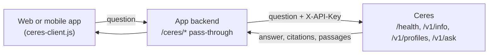

# ceres-js

A drop-in JavaScript client for Ceres, Veridian's agronomy question-answering service.

Ceres answers a question only from the passages of a document release. It returns the answer text, the citations that support
it, and the passages it retrieved. When the library does not support an answer, Ceres declines and says what is missing.
ceres-js sends the question, checks the input, and turns the Ceres response into one plain object that an app can render.

The client is one ES module, `src/ceres-client.js`. It has no dependencies and no build step. It uses only `fetch` and
`AbortController`, and it never touches the page. It runs unchanged in plain web pages, React, Vue, React Native and Node 18+.

## Terms

- **Release**: a versioned set of documents, split into passages and stored for retrieval. Ceres serves one release at a time.
- **Passage**: one piece of a document (a page or a section) that Ceres retrieved for a question. Each passage has an evidence
  id (`E1`, `E2`, …).
- **Citation**: a link from a part of the answer (the claim) to a passage, with the exact supporting words (the quote).
- **Route**: the fixed set of retrieval, reranking and answer settings that Ceres serves. Ceres reports it as a route id.
- **Profile**: who is asking (a user persona, for example a farmer or an insurer). Ceres can adapt the answer to it.
- **Conversation**: a series of questions that share a conversation id, so that Ceres can answer follow-ups.

## How it fits in an app



The app talks to its own backend. The backend adds the Ceres API key and forwards the request to Ceres.

## Install

There is no npm registry package. Use one of these:

- **Copy the file.** Copy `src/ceres-client.js` into your app and import it by path:
  `import { createCeresClient } from "./ceres-client.js";`
- **Install from the git repository.** `npm install git+<repository URL>`, then
  `import { createCeresClient } from "ceres-js";`.

Requirements: Node 18 or later for Node use and for the tests; the proxy tests also need `python3` (3.10 or later). Browsers
and React Native need a global `fetch`.

## Quick start

Run the tests. They need no Ceres, no internet access and no GPU, but they do need loopback sockets: the proxy tests start
local servers on `127.0.0.1`, so a sandbox that blocks `listen` makes them fail with `EPERM`:

```bash
npm test
```

Ask a question from Node. This requires a running Ceres, reached directly or through one of the proxies in `proxy/`:

```bash
# 1. Start the Node proxy in front of Ceres (it serves the examples too).
CERES_URL=<Ceres base URL> CERES_API_KEY=<key> PORT=8320 npm run demo     # → http://127.0.0.1:8320

# 2. Ask through the proxy.
CERES_BASE_URL=http://127.0.0.1:8320/ceres \
  node examples/node/ask.mjs "What did the many high rainfall events in central Europe lead to in spring 2013?" en
```

The example prints the decision and reason code, the total time, the release id, the answer, and each citation (or, for a
decline, each missing item):

```
ANSWER (SUPPORTED) · 10.0 s · <release id>
The many high rainfall events in central Europe led to vast flooding in the vicinity of the rivers affected and …
  [1] <section id>: "flooding in the vicinity of the rivers affected"
```

`CERES_BASE_URL` defaults to `http://127.0.0.1:8320/ceres`. To try the client without a real Ceres, point `CERES_URL` at the
stand-in Ceres from the sibling repository `ceres-chat` (published next to this one, in the same organization; file
`tools/fake_ceres.py`), which replays recorded responses. In a
checkout of `ceres-chat` (after its `bash setup_venv.sh`), start it on a free port, then start the proxy against it:

```bash
# in ceres-chat:
.venv/bin/python tools/fake_ceres.py 8399
# in ceres-js, another terminal:
CERES_URL=http://127.0.0.1:8399 CERES_API_KEY=any node proxy/node/server.mjs
```

The stand-in accepts any key.

## Client API

```js
import { createCeresClient, CeresError, newConversationId } from "./ceres-client.js";

const ceres = createCeresClient({ baseUrl: "/ceres" });   // your backend's pass-through to Ceres

const reply = await ceres.ask("Care este densitatea optimă de semănat la floarea-soarelui?", { lang: "ro" });
if (reply.answered) render(reply.answer, reply.citations, reply.passages);
else showDecline(reply.answer, reply.missingInformation);
```

### `createCeresClient(options)`

| Option | Type | Default | Meaning |
|---|---|---|---|
| `baseUrl` | string | required | Where the Ceres API is reachable: your backend's pass-through (`"/ceres"`, `"https://api.example.com/ceres"`), or Ceres itself for local tests. |
| `getToken` | `() => string \| null \| Promise<…>` | none | Returns a bearer token for the current user. It is sent as `Authorization: Bearer …`. Ceres does not check it yet; it is the hook for per-user auth in your backend. |
| `timeoutMs` | number | `120000` | Give up after this many milliseconds. The limit covers the whole call: `getToken`, the request and reading the answer. An answer usually takes 10–20 s. |
| `fetch` | function | global `fetch` | A `fetch` implementation. |
| `headers` | object | none | Extra headers on every request. |

The client has four methods:

| Method | Request | Returns |
|---|---|---|
| `ask(question, opts)` | `POST /v1/ask` | a `Reply` (below) |
| `health(opts?)` | `GET /health` | `{ ready, … }` from Ceres; needs no key |
| `info(opts?)` | `GET /v1/info` | which release and route Ceres serves |
| `profiles(opts?)` | `GET /v1/profiles` | `[{ id, role, language, summary }]`; `[]` when Ceres has no profiles |

Every method accepts `{ signal }` (an `AbortSignal`) to cancel the request.

### `ask(question, opts)`

| Argument | Type | Meaning |
|---|---|---|
| `question` | string | Required. Trimmed; it must not be empty and must be 2000 characters or fewer. |
| `opts.lang` | `"en"` \| `"ro"` | Required. The language of the question and the answer. |
| `opts.conversationId` | string | Optional. 8–64 letters, digits, `_` or `-`. Use `newConversationId()` once per chat and pass it on every question of that chat. Ceres then understands follow-ups ("And for maize?"). |
| `opts.profileId` | string | Optional. A profile id from `profiles()`. Keep it the same for the whole conversation. |
| `opts.requestId` | string | Optional; 1–200 characters. Pass it when you may retry. Ceres replays a completed request instead of storing the turn twice. |
| `opts.signal` | `AbortSignal` | Optional. Cancels the request, for example when the user leaves the screen. |

The client checks all arguments before it sends anything. A bad argument throws a `CeresError` with kind `bad_request` or
`too_long`.

### The reply

```js
reply.decision            // "ANSWER", or a decline such as "UNSUPPORTED"; treat any other value as a decline
reply.answered            // decision === "ANSWER"
reply.answer              // the text to show (also the decline message)
reply.confidence          // "HIGH" | "MEDIUM" | "LOW" | null
reply.reasonCode          // "SUPPORTED", "NO_RELEVANT_SUPPORT", "LIVE_DATA_REQUIRED", … or null
reply.citations           // [{ number, evidenceId, claim, quote, passage }]
reply.passages            // [{ evidenceId, source, pageIndex, sectionId, text, cited, citationNumber, warnings, document }]
reply.missingInformation  // for a decline: what the library lacks
reply.question, reply.lang
reply.meta                // { releaseId, routeId, latencyMs: { embed, retrieve, rerank, answer, total }, state }
reply.memory              // how Ceres read the question (below), or null
reply.raw                 // the full Ceres response, unchanged
```

**Citations.** `number` is the display number. Citations that point at the same passage share a number, and numbers follow
the order of first citation. `claim` is the part of the answer the citation supports. `quote` is the exact supporting text
in the passage. `passage` is the cited passage object, or `null`.

**Passages.** `evidenceId` is what citations point at. `sectionId` is the full id of the page or section. `source` is the
document id and `pageIndex` the 0-based page (or `null` when the passage is a section). `cited` and `citationNumber` say
whether and how the answer cites it. `warnings` lists quality warnings from the pipeline.

`document` holds readable source details when Ceres sends them, else `null`:

```js
passage.document  // { title, authors: [...], language, pageLabel, display }
                  // display is ready to show: "Title — First Author et al., PDF p. 76"
                  // pageLabel is the PDF page ("PDF p. 76"), not the printed page number, or "section 5"
```

**Declines.** Ceres answers only from the release. When the passages do not support an answer, `answered` is `false`,
`answer` explains why, `missingInformation` lists what is missing, and `reasonCode` says which kind of decline it is. Reason
codes that Ceres uses for declines include `NO_RELEVANT_SUPPORT`, `LIVE_DATA_REQUIRED`, `CURRENT_AUTHORITY_REQUIRED`,
`CONTRACT_OR_POLICY_REQUIRED`, `PREDICTION_NOT_SUPPORTED` and `MISSING_USER_OR_PARCEL_INFORMATION`.

**Memory.** `memory` is present when the request used a conversation or a profile:

```js
reply.memory  // { conversationId, turn, profileId, understoodAs, searchQuery, isFollowup, rewriteStatus }
```

`understoodAs` is the stand-alone question that Ceres answered ("And for maize?" becomes "What is the optimal sowing density
for maize?"). Show it as "Understood as: …". `searchQuery` is what Ceres searched with. `rewriteStatus` is `ok`, `skipped`,
`fallback` or `transport_failed`.

```js
const conversationId = newConversationId();
await ceres.ask("What is the optimal sowing density for sunflower?", { lang: "en", conversationId });
const r = await ceres.ask("And for maize?", { lang: "en", conversationId });
r.memory.understoodAs;   // "What is the optimal sowing density for maize?"
```

`normalizeReply(raw)` is exported too. It turns a stored raw Ceres response into the same `Reply`.

### Errors

Every failure of a request, including a connection that breaks while the answer is read and a reply of the wrong shape (`bad_response`), is a `CeresError`. Switch on `error.kind`; `error.retryable` is `true` when a later retry may work.

| Kind | Cause | Retryable |
|---|---|---|
| `bad_request` | invalid input, or HTTP 400 / 422 | no |
| `too_long` | the question exceeds 2000 characters, or HTTP 413 | no |
| `unauthorized` | HTTP 401 / 403 (missing or wrong key), or `getToken` failed | no |
| `busy` | HTTP 429 (Ceres is at its limit) | yes |
| `not_ready` | HTTP 503 (Ceres is starting or warming up) | yes |
| `server_error` | other HTTP 5xx | yes |
| `network` | Ceres or the proxy cannot be reached | yes |
| `timeout` | no complete answer within `timeoutMs` (token, request or body) | yes |
| `aborted` | the caller cancelled with `signal` | no |
| `bad_response` | the response is not a Ceres answer | no |

`error.status` holds the HTTP status (or `null`) and `error.detail` the server's detail.

## The proxy: keep the API key on the server

Ceres requires an API key in the `X-API-Key` header. Anything shipped to a browser or a phone can be read by its user, so the
key must never be in app code. The app's backend holds the key, checks its own user session, and forwards `/ceres/*` to Ceres.

`proxy/` has a minimal pass-through in two versions, to copy into a real backend:

| | Command | Default port |
|---|---|---|
| Node 18+ (no dependencies) | `npm run demo` or `node proxy/node/server.mjs` | 8320 |
| Python 3.10+ (standard library) | `npm run demo:py` or `python3 proxy/python/server.py` | 8321 |

Both read the same environment variables:

| Variable | Meaning |
|---|---|
| `CERES_URL` | Ceres base URL. Set it explicitly. |
| `CERES_API_KEY` | The API key, or |
| `CERES_API_KEY_FILE` | a file whose content is the key. |
| `PORT`, `HOST` | Where the proxy listens (default host `127.0.0.1`). |

Both proxies forward only `GET /health`, `GET /v1/info`, `GET /v1/profiles` and `POST /v1/ask`, add the key, and never return
it. Every other `/ceres/*` path is a 404. They also serve the example pages and `src/`, so pages and API share one origin and
need no CORS. A static request is served only when its real path (after decoding, normalisation and symlink resolution) lies
inside `examples/` or `src/`; anything else is a 404. Open `http://127.0.0.1:8320/` for the example index. In a real backend, put the `/ceres` route behind your login
and verify the user's token before forwarding.

## Framework examples

- **Vanilla JS**: `examples/vanilla/index.html`, a plain page with the client imported as a module.
- **React**: `examples/react/index.html`, a `useCeres` hook (React loaded from a CDN, no build).
- **Vue**: `examples/vue/index.html`, a `useCeres` composable (Vue loaded from a CDN, no build).
- **React Native**: `examples/react-native/AskScreen.js`, a screen component; copy `src/ceres-client.js` next to it (not run in
  the test suite).
- **Node**: `examples/node/ask.mjs`, a command-line script for scripts and backend jobs.

In a real app, React and Vue come from npm, not a CDN.

## Testing

```bash
npm test        # node --test test/*.test.mjs
```

The suite has 34 tests. It needs no internet access or external service, but it opens local sockets on `127.0.0.1`
(loopback must be allowed):

- `test/client.test.mjs` runs the client on recorded Ceres responses (an answer, a decline, a memory follow-up) and on fakes
  for every error kind, timeout, cancellation, `getToken`, citation numbering, memory fields and readable sources.
- `test/proxy.test.mjs` starts both proxies against a fake Ceres. It checks that the key is added and never returned, that
  only the four endpoints are forwarded, and that no file outside `examples/` and `src/` is served: `../` and `%2e%2e%2f`
  traversal, absolute paths, sibling directories such as `examples-secret/` and symlinks pointing outside all return 404.

## Test data sources

The test data quotes passages, tables or page text from 5 public JRC MARS Bulletins (European Commission, Joint Research Centre), for testing only. Of these 5 documents, 5 state "Reproduction is authorised provided the source is acknowledged". [docs/TEST-DATA-SOURCES.md](docs/TEST-DATA-SOURCES.md) lists each document, the folder that quotes it, its credit line and its reuse terms, and which fixture metadata values are examples. The rest of the test data is invented or recorded from this software's own runs. Third-party material keeps its own terms; the proprietary licence covers the rest of the repository.

## License

Proprietary. See LICENSE.

## Development process

Development process: docs/DEVELOPMENT.md
